# 熊喵AI写作 · XiongMao AI Writer

一款本地运行的 **全自动小说创作桌面软件**：输入一句灵感，自动产出书名、简介、标签、封面、设定库、分卷大纲与章节细纲，并持续写作上千章，同时解决长篇连载最致命的问题——**记忆与连贯性**。

**长篇小说与短故事是两套独立流程**：书库分栏管理，入口分开，结构不同（长篇拆卷分章，短故事 7 拍一次成篇），互不干扰。

内置番茄小说作家后台浏览器，登录后可 **接口直发**，不用再去浏览器里复制粘贴。

---

## 功能总览

| 模块 | 能力 |
| --- | --- |
| **零输入全自动** | 不需要灵感、风格或任何写作经验：AI 自主判断平台方向，决定题材/受众/文风/书名/设定/大纲，一键开书 |
| 一键开书 | 灵感 → 3~5 个选题方案 → 书名/简介/标签/开篇钩子/爽点 |
| 短故事 | 独立入口：7 拍结构（常态→激励→升级→反转→低谷→高潮→结局）→ 一次性成篇 3000~12000 字，不拆卷、不分章、结尾闭合 |
| 设定库 | 世界观、力量体系、硬规则、人物（含状态）、势力、地点、道具、伏笔 |
| 分卷大纲 | 按目标章节数自动拆卷，每卷含核心矛盾、对手、卷末高潮 |
| 章节细纲 | 每章 3~6 个节拍，标注埋设/回收伏笔与结尾钩子 |
| 自动写作 | 上下文编排 → 流式正文 → 篇幅补写 → 摘要固化 → 一致性审校 → 自动修稿 |
| 长篇记忆 | 分层上下文 + 滚动摘要 + BM25/向量混合检索 + 实体状态机 + 伏笔台账 |
| 封面管理 | 本地模板一键换样式、AI 绘图、上传自己的图片，实时预览 |
| 阅读与修改 | 章节列表点开即读全文，随时进入编辑器改稿；短故事同样支持 |
| 完结判断 | 达到目标章数后由审校模型判断主线与伏笔是否收束；未收束继续写（上限 +10%），已收束自动标记完结并生成结局章 |
| 断点续写 | 流式写作每 6 秒保存草稿，暂停/退出不丢；重启从最后一章继续，不覆盖已完成正文 |
| 错误与恢复 | 真实显示 HTTP / 额度 / 超时错误；5xx、429 自动重试；失败章节不留假正文 |
| 导出 | TXT（UTF-8 BOM + CRLF）与 EPUB（目录、章节、XHTML），标题与特殊字符完整保留 |
| 日志 | 实时进度条、暂停/停止、日志面板，长任务可随时中断与恢复 |
| 外观主题 | 深色 / 浅色主题 + 7 种主题色（琥珀、海蓝、青绿、紫罗兰、玫瑰、青蓝、赤红），实时生效并记忆 |
| 番茄后台 | 内置浏览器登录（登录态本地保存）、请求录制回放、页面自动化、复制人工 |
| 质量控制 | 每章审校（设定/时间线/人物/逻辑/重复/文风），严重冲突自动修稿 |

---

## 界面预览

| 章节管理 | 正文编辑 |
| --- | --- |
| 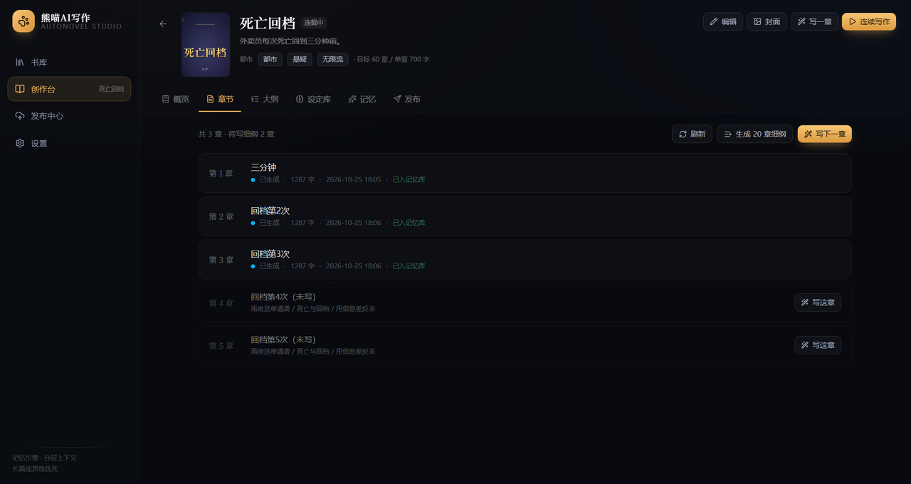 | 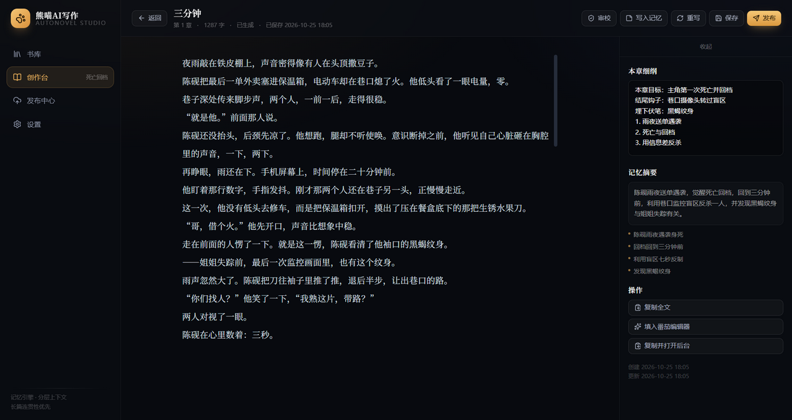 |

| 记忆面板 | 发布中心 |
| --- | --- |
| 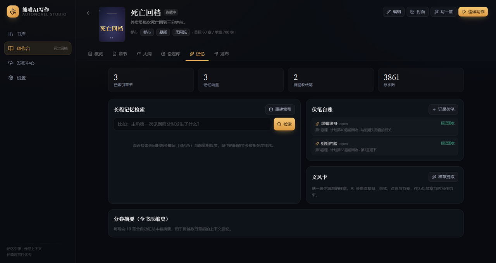 | 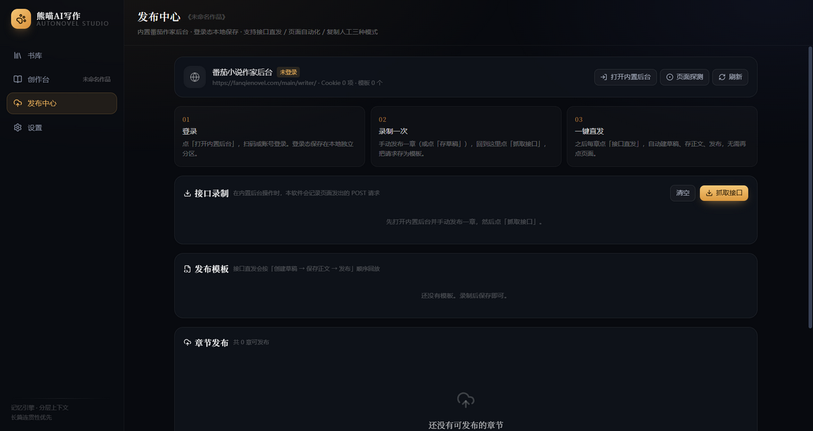 |

| 短故事工作台 | 7 拍结构 |
| --- | --- |
| 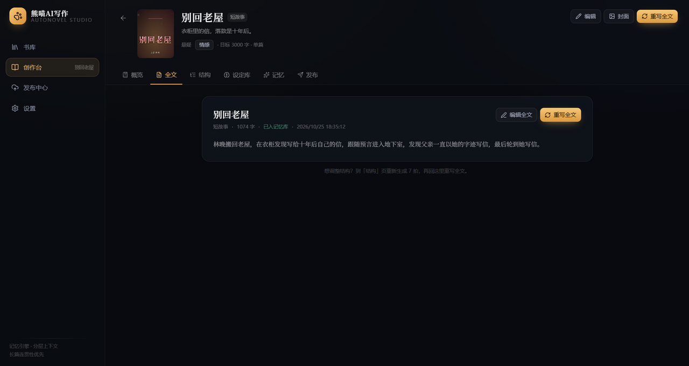 | 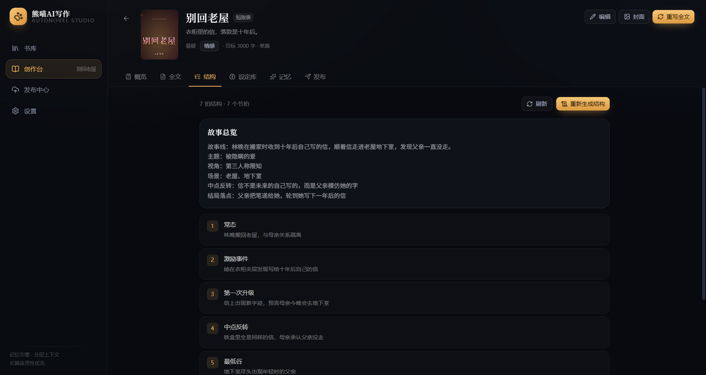 |

| 封面管理 | 章节阅读 |
| --- | --- |
| 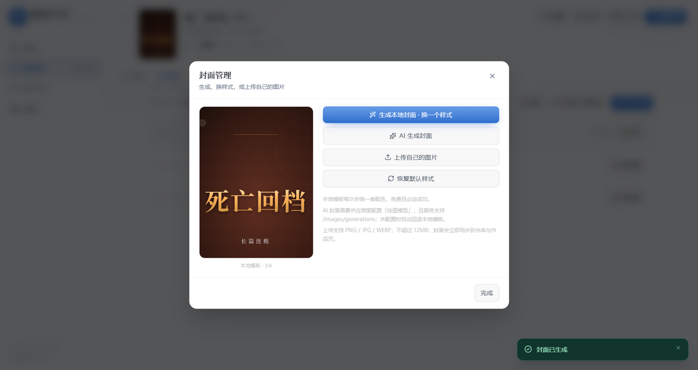 | 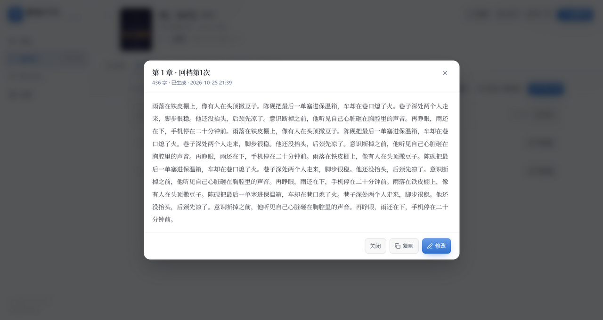 |

| 浅色主题 · 蓝色 | 深色主题 · 外观设置 |
| --- | --- |
| 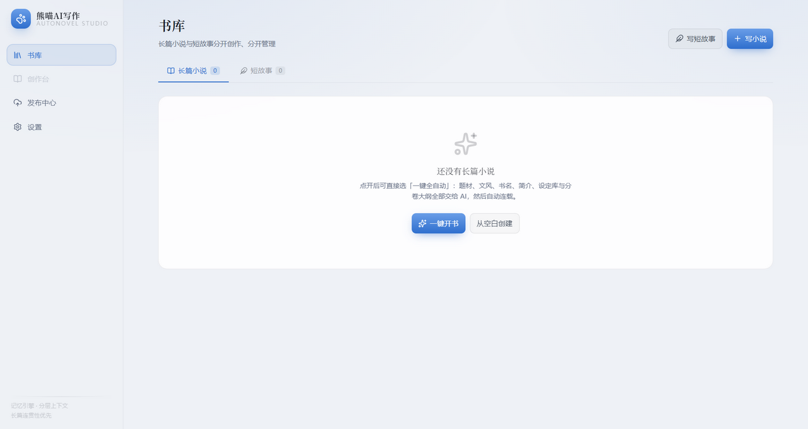 | 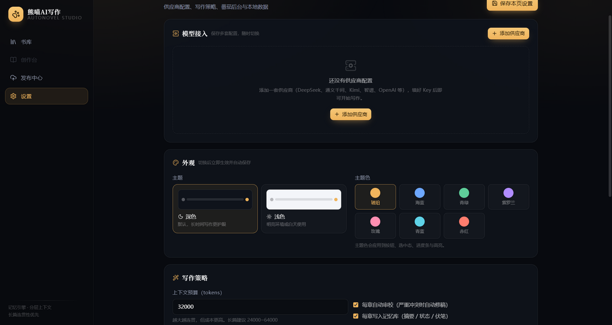 |

| 零输入全自动开书 |
| --- |
| 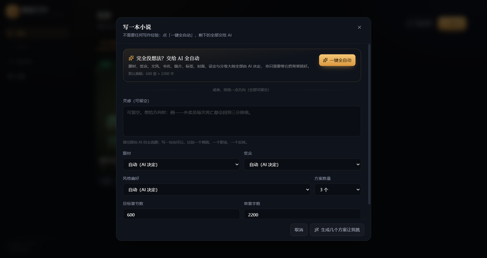 |

---

## 技术栈

- **Electron 45** + **React 19** + **TypeScript 5.9** + **Vite 8**（electron-vite 6）
- **Tailwind CSS 4** 深色界面
- **sql.js（SQLite WASM）** 本地持久化，无原生模块、免编译
- OpenAI 兼容协议（Chat Completions / Embeddings / Images），可接任意兼容服务

---

## 快速开始

系统要求：**Windows 10/11 64 位（x64）**。

```bash
npm install
npm run dev
```

若提示 `Electron failed to install correctly`（国内网络常见），单独补下载：

```bash
set ELECTRON_MIRROR=https://npmmirror.com/mirrors/electron/ && node node_modules/electron/install.js
```

生产构建：

```bash
npm run build        # 产物在 out/
npm run dist         # 打 Windows 安装包到 release/
```

国内网络下打包若卡在下载 Electron：

```bash
set ELECTRON_MIRROR=https://npmmirror.com/mirrors/electron/ && npm run dist
```

---

## 模型接入

设置页的「模型接入」是一套 **多供应商配置管理器**（类似 CC Switch）：

1. 点 **添加供应商**，从目录里选一个（或选「自定义配置」）：搜索、分类筛选都支持。
2. 在表单里确认 API 地址、填 API Key、检查模型分工，点 **保存并启用**。
3. 保存后供应商出现在列表里，当前使用的会高亮并显示「使用中」。
4. 列表里每套配置都可以 **切换 / 测试 / 编辑 / 删除**，互不覆盖。

供应商目录（模型名为可编辑示例；点「拉取模型列表」后，每个模型字段右侧的下拉可直接选择）：

| 分组 | 供应商 |
| --- | --- |
| 国内主流 | DeepSeek、通义千问、豆包·火山方舟、Kimi 月之暗面、智谱 GLM、腾讯混元、百度文心、讯飞星火 |
| 国际 | OpenAI、Google Gemini |
| 聚合平台 | OpenRouter、硅基流动 |
| 本地 | Ollama、LM Studio、vLLM |
| 自定义 | 任意 OpenAI 兼容地址（需含 `/v1`） |

模型分工（每套供应商独立保存，留空则回退默认模型）：

- 策划模型：选题 / 设定 / 大纲
- 写作模型：正文（建议用最强模型）
- 摘要模型：章节 / 卷摘要（可用便宜模型，量大）
- 审校模型：一致性检查
- 向量模型：留空时自动使用**本地哈希向量**
- 绘图模型：留空时封面使用本地模板

> 供应商配置独立保存；设置页右上角的「保存本页设置」只保存写作策略与番茄后台。
> 上下文预算默认 32000 tokens，写 1000+ 章建议 24000~64000。

---

## 写作流程

书库顶部有两个入口：**写小说** 与 **写短故事**，作品也在两个分栏里独立管理。

打开任一入口后，最上方就是 **「完全没想法？交给 AI 全自动」**：

- 点 **一键全自动**：AI 自己决定题材、受众、文风、书名、简介、标签、封面、设定与结构，直接建好作品；不需要填任何内容。
- 想给一点方向时再填：灵感、题材、受众、风格偏好、篇幅，全部可留空；留空的部分由 AI 决定。
- 也可以点「生成几个方案让我挑」，从 1~5 个完整方案里选一个。

### 长篇小说

1. **写小说 → 一句话开书**：填灵感、类型、目标章节数、单章字数。
2. AI 生成方案，选一个（可手动改书名/简介/标签）→ **创建并自动搭建**。
3. 自动完成：设定库 → 分卷大纲 → 首章 5 章细纲 → 封面。
4. 创作台 **章节** 页：
   - **写下一章**：单章生成并跳到编辑器。
   - **连续写作**：批量 N 章，或勾选「一直写到目标章节数」，底部进度条实时显示，可暂停/停止。
5. 编辑器里可 **审校 / 写入记忆 / 重写 / 发布**；`Ctrl+S` 保存，停止输入 1.5 秒自动保存。
6. **查看与改稿**：章节列表点击任意一章即可阅读全文，点「修改」进入编辑器。

### 短故事

1. **写短故事 → 一句话写短故事**：填灵感、题材、目标字数（3000 / 5000 / 8000 / 12000）。
2. AI 生成方案（含结构预览），选一个 → **创建并拆结构**。
3. 自动完成：人物与精简设定 → 7 拍故事结构 → 封面。
4. 创作台 **全文** 页：点 **写完整篇**，一次性生成完整故事；可 **重写全文**。
5. **结构** 页可单独重生成 7 拍；**全文** 页不显示章节、连续写作与卷纲概念。

> 短故事同样会写摘要、抽取事实与伏笔，保证篇内自洽；但不建立分卷与长程检索压力。

## 封面与外观

- 作品页点 **「封面」**：本地模板换样式、AI 生成、上传自己的图片、恢复默认，全部即时预览并同步到书库。
- **设置 → 外观**：深色 / 浅色主题，7 种主题色（琥珀、海蓝、青绿、紫罗兰、玫瑰、青蓝、赤红），点击立即生效并自动保存。
- 浅色主题会自动压暗主题色，保证按钮与文字对比度；主题色会应用到按钮、选中态、进度条与高亮。

## 导出

作品页点 **「导出」**：

- **TXT**：UTF-8 带 BOM、CRLF 换行，Windows 记事本可直接打开；按章号顺序输出标题与正文。
- **EPUB**：EPUB 3，带目录、章节 XHTML 与样式，可用 Apple Books / 多看 / Calibre 打开；短故事导出为单篇。
- 文件名会过滤 Windows 非法字符；章节标题与正文中的 `< > & " '` 在 EPUB 中正确转义，在 TXT 中保持原样。

---

## 长篇连贯性是怎么解决的

详见 [docs/MEMORY.md](docs/MEMORY.md)。核心是 **五层记忆 + 写后固化**：

```
L0 硬设定（锁定条目、规则、力量体系）      ── 每章必注入
L1 人物/势力状态卡（随章更新的 state）      ── 相关人物优先
L2 分卷摘要（全书压缩史）                  ── 远处剧情不丢
L3 最近 8 章滚动摘要                       ── 近况细节
L4 BM25 + 向量混合检索（久远但相关的情节）  ── 按当前细纲召回
L5 上一章结尾原文                          ── 语感与衔接
   + 未回收伏笔台账                        ── 防挖坑不填
```

每章写完自动执行：

1. 生成摘要 / 关键事件 / 新事实 / 伏笔变动（结构化 JSON）；
2. 抽取角色与势力状态变化，合并进设定库 `state`；
3. 建立该章摘要向量索引；
4. 每 10 章滚动合并一次本卷摘要；
5. 审校正文并给出可修复的问题清单，严重问题自动修稿后重新固化记忆。

上下文预算不足时，按优先级从 L5→L4→L3 裁剪，L0 与伏笔永不丢。

---

## 番茄小说直发

详见 [docs/FANQIE.md](docs/FANQIE.md)。三条路径，从稳到快：

1. **复制 + 人工确认**：复制正文并打开内置后台，你粘贴发布（最稳）。
2. **页面自动化**：自动定位标题框与正文编辑器写入内容，可选自动点「发布」。
3. **接口直发（推荐）**：首次手动发布一章，软件录制真实接口，之后一键完成「建草稿 → 存正文 → 发布」。

首次配置（只需一次）：

```
发布中心 → 打开内置后台 → 登录
→ 手动发布一章 → 回到发布中心点「抓取接口」
→ 把三个请求分别标注为 创建草稿 / 保存正文 / 发布 → 存为模板
```

之后每章点 **直发** 即可。登录态保存在独立分区 `persist:fanqie`，重启软件不丢。

> 平台接口可能调整。若直发失败，改用「填入页面」或「复制」，或重新录制一次模板。

---

## 文档

- [架构说明](docs/ARCHITECTURE.md)：进程划分、数据流、数据库表、降级策略
- [长篇记忆引擎](docs/MEMORY.md)：五层上下文、混合检索、写后固化、规模表现
- [番茄发布适配](docs/FANQIE.md)：三种模式、录制回放、参数注入、故障排查
- [验收报告](docs/ACCEPTANCE.md)：10 项真实运行结果、修复记录与未覆盖项

## 目录结构

```
熊喵AI写作/
├─ src/
│  ├─ main/                    # 主进程
│  │  ├─ index.ts              # 窗口与生命周期
│  │  ├─ settings.ts           # 设置加载/加密保存
│  │  ├─ db/                   # SQLite：schema / 持久化 / 仓库层
│  │  ├─ llm/                  # OpenAI 兼容客户端 + 全部提示词
│  │  ├─ memory/               # 上下文编排、检索、摘要、审校
│  │  ├─ pipeline/             # 书籍铸造、单章写作、批量调度
│  │  ├─ cover/                # 封面生成（本地 SVG + AI）
│  │  ├─ publish/              # 番茄后台：注入脚本、录制回放、DOM 自动化
│  │  └─ ipc/                  # 全部 IPC 处理器
│  ├─ preload/                 # contextBridge 暴露 window.api
│  ├─ renderer/                # React 界面
│  │  └─ src/{pages,components,store,lib}
│  └─ shared/                  # 主/渲染共用类型与 API 契约
├─ docs/                       # 架构 / 记忆 / 发布说明
├─ data/                       # 开发态本地数据（数据库、封面）
├─ resources/                  # 打包资源
└─ out/                        # 构建产物
```

---

## 数据与备份

- 开发态：`<项目>/data/xiongmao.db`、`<项目>/data/covers/*.png`
- 安装后：`%APPDATA%/熊喵AI写作/data/`
- 设置页可直接打开数据目录。
- 数据库每 700ms 防抖落盘，退出前强制写入；建议定期整目录备份。

---

## 常见问题

**Q：生成很慢 / 一直不动？**
A：检查 API 地址与 Key；用「测试连接」；长章节单次输出较大，建议写作模型支持 8k+ 输出。

**Q：章节之间人名/等级不一致？**
A：把关键人物与规则设为 **锁定**；确认每章写完后「已入记忆库」；在设定库补全人物 `state`。

**Q：想换模型？**
A：设置里按用途分别指定即可，摘要/审校可用便宜模型显著降本。

**Q：接口直发报错？**
A：平台接口变了。重新录制一次模板；或改用页面自动化 / 复制模式。

**Q：能在多台电脑同步吗？**
A：当前是本地单机存储，复制整个 `data/` 目录即可迁移。

---

## 打包

```bash
npm run dist
```

输出 `release/XiongMaoAIWriter-<version>-x64.exe`（NSIS 安装包）。

---

## 许可

私有项目，未授权分发。
